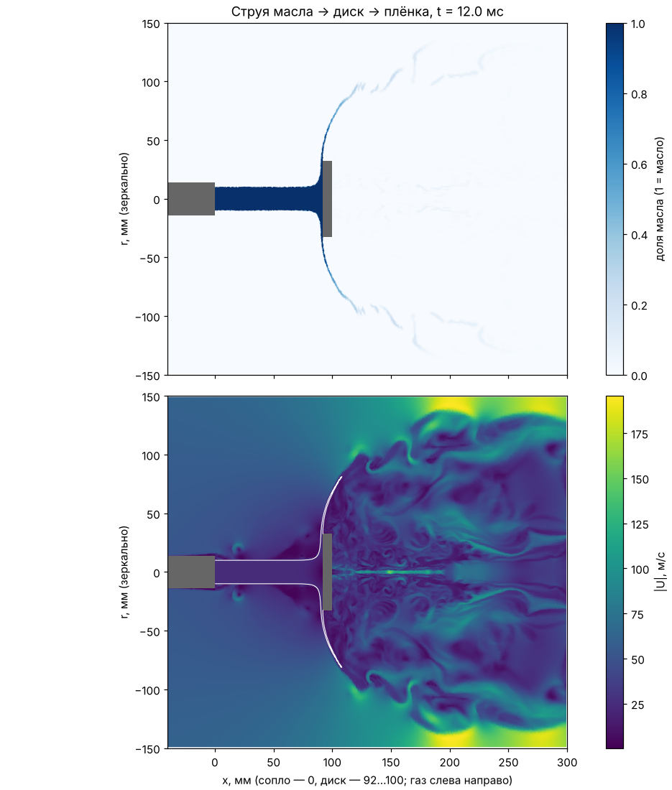

# nozzle-vof: струя масла → отражательный диск → плёнка (VOF)

Отдельная маленькая задача, без скруббера. Цель — **посчитать, а не задать** то, что в `case-rim` принято на глаз:
- под каким углом масло сходит с кромки диска;
- с какой скоростью и какой толщины плёнкой;
- что с ней делает обтекающий газ.

Масло и газ считаются как две несмешивающиеся жидкости с границей раздела (метод VOF, решатель `incompressibleVoF`). Капель-частиц здесь нет: струя, растекание по диску и плёнка за кромкой получаются из уравнений.

## Постановка

| | |
|---|---|
| Геометрия | осесимметричный клин 5° (2D), ось x — ось форсунки |
| Сопло | отверстие ⌀20 мм на торце корпуса ⌀28 мм (x = 0); трубка до сопла не моделируется |
| Диск | ⌀65 мм, толщина 8 мм, обращён к соплу, x = 92…100 мм |
| Область | x −150…300 мм, r 0…150 мм; внешняя граница — гладкая стенка (`slip`) |
| Масло | 32 т/ч → 24.6 м/с из ⌀20; ρ 1150, ν 40 сСт (100 °C), σ 0.030 Н/м |
| Газ | 55 м/с вдоль оси + закрутка твёрдым телом ω = 167 рад/с (25 м/с на r = 150 мм); ρ 1.106, μ 1.82e-5 (470 °C) |
| Турбулентность | нет (`laminar`): граница раздела разрешается сеткой |
| Тяжесть | выключена (осесимметрично; при 25 м/с она не важна) |
| Сетка | `make_mesh.py`, ячейки 0.4 мм у струи и диска → 107 тыс. ячеек; `python make_mesh.py 1.5` → 0.27 мм, 242 тыс. |
| Время | 12 мс: струя доходит до диска за ~3.7 мс, плёнка проходит до r = 150 мм к ~10 мс |

**Ограничения:**
- В клине нет трёхмерного распада плёнки на нити и капли. Плёнка остаётся сплошным «листом», пока её толщина больше ячейки, затем размазывается.
- Поэтому достоверны **угол, скорость и толщина плёнки у кромки** (r 35–60 мм). Дальше — только качественно.
- Закрутка в клине есть: она меняет угол схода через центробежную силу, но не рвёт плёнку.
- Газ в начале стоит «рывком»: за диском первые миллисекунды ходит стартовый вихрь до 140 м/с. Он и задаёт мелкий шаг по времени (~1.3 мкс).

## Запуск

Из папки кейса. На 8 ядрах примерно 1–1.5 часа.

```bash
cd $FOAM_RUN/CFD-Venturi/nozzle-vof
```

```bash
./Allrun
```

Посмотреть, что получилось (можно и во время расчёта — возьмёт уже записанное):

```bash
./pictures
```

Пишет `sheet_<шаг>.png` на каждую запись (каждые 0.2 мс, ~60 кадров), **анимацию `sheet.gif`** из всех кадров и `sheet_summary.txt` — таблицу плёнки за кромкой для последнего момента: x, толщина, скорость, угол к оси на радиусах 35–140 мм. Уже нарисованные кадры повторно не рисуются, так что `./pictures` во время расчёта только дорисовывает новые. Весь набор — минут 10–15 (чтение VTK). GIF открывается браузером.

Остановить с записью: `./stop`. Продолжить: снова `foamRun` (`mpirun -np 8 foamRun -parallel` или `./Allrun` без `Allclean` — `startFrom latestTime`). Очистить всё: `./Allclean`.

**В ParaView:** `case.foam` (создать пустой файл), поле `alpha.oil`, фильтр `Reflect` по Y — получится полное сечение.

## Что можно менять

| Где | Что |
|---|---|
| `make_mesh.py`: `X`, `R` | расстояние сопло–диск (`X[2]`, `X[3]`), радиус диска (`R[3]`), сопла (`R[1]`) |
| `0.orig/U`, `oilInlet` | скорость масла (при другом сопле: расход / площадь) |
| `0.orig/U`, `gasInlet` | скорость газа и закрутка (`omega 0` — без закрутки) |
| `constant/phaseProperties` | σ |
| `constant/physicalProperties.oil` | ν, ρ |

## Результат проверочного расчёта (в облаке Claude, 4 ядра, ~2.5 ч)

Анимация: `docs/nozzle_vof_sheet.gif` (0–12 мс, кадр 0.2 мс); последний кадр: `docs/nozzle_vof_12ms.png`.



- Струя доходит до диска за ~3.7 мс; плёнка проходит за кромку и к 12 мс доходит до r ≈ 100–130 мм.
- Плёнка за кромкой на 12 мс (`sheet_summary.txt`):

| r, мм | x, мм | толщина, мм | скорость, м/с | угол к оси |
|---|---|---|---|---|
| 35 (кромка) | 91.3 | 1.6 | 23.1 | — |
| 45 | 92.4 | 1.6 | 23.2 | 83° |
| 60 | 96.6 | ~2 | 23.3 | 74° |
| 80 | 106.8 | ~2.7 (размыта) | 23.8 | 63° |

- Толщина у кромки совпадает с оценкой по расходу: 7.73 л/с / (2π · 32.5 мм · 23 м/с) ≈ 1.65 мм.
- **Вывод для `case-rim`:** принятые там 80–95°, 25 м/с, ~1.5 мм подтверждаются. Точнее: ~85° у кромки, 23 м/с, 1.6 мм; дальше газ загибает плёнку вниз по потоку (63° на r = 80 мм).

**Чему не верить:**
- сплошной «зонтик» до r ≈ 100 мм: в 2D плёнка не рвётся на нити и капли, газ вынужден обходить её по внешней стенке (там 150+ м/с);
- тонкая быстрая струя на оси за диском: особенность клиновой сетки на оси.

Оба эффекта после ~8 мс уменьшают шаг по времени до 0.1–0.3 мкс (поэтому вторая половина расчёта медленнее первой), но на параметры плёнки у кромки не влияют.
